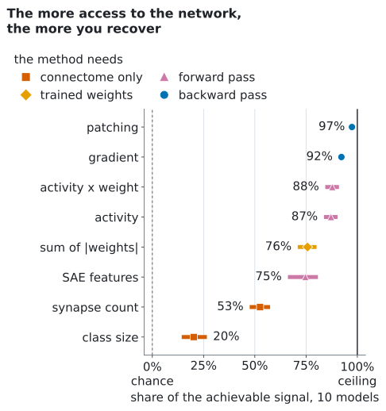
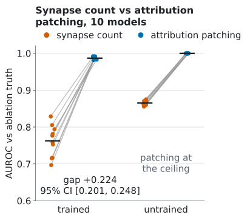
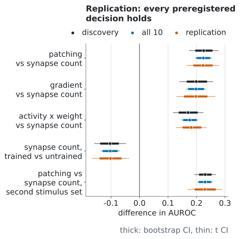

<h1 align="center">flyvis-circuit-bench</h1>

<p align="center"><b>How much of what a neural circuit relies on can you read off its wiring diagram? A benchmark
of circuit-discovery methods against exact ablation ground truth in a connectome-constrained model of the fly
visual system.</b></p>

<p align="center">
  <a href="../../actions/workflows/ci.yml"></a>
  <a href="LICENSE"></a>
  <a href="LICENSE-data"></a>
  
  <a href="https://colab.research.google.com/github/natiixnt/flyvis-circuit-bench/blob/main/notebooks/score_your_method.ipynb"></a>
</p>

<p align="center">
  <picture>
    <source media="(prefers-color-scheme: dark)" srcset="docs/figures/hero-dark.svg">
    
  </picture>
</p>

## TL;DR

We switched off, one at a time, each of the 604 cell-type-to-cell-type connection classes in 10 trained models of
the fly visual system ([flyvis](https://github.com/TuragaLab/flyvis), Lappalainen et al., Nature 2024) and
measured how much the network response changes. That is the ground truth. Attribution patching, which estimates
the same effect from gradients, is the reference: it recovers **97%** of the achievable signal (AUROC 0.987).
The question is how much the anatomy gives on its own.

- **Anatomy alone recovers about half.** Ranking connections by synapse count recovers 53% of the achievable
  signal (AUROC 0.763); synapse counts put 17 of the 61 most important connections in their own top 61
  (precision@61, a metric added after the preregistration).
- **One learned scalar per connection class closes about half of the remaining gap.** In flyvis a weight is
  synapse count times one trained strength per class; ranking by the sum of |weights| recovers 76% (AUROC
  0.878), 49% of the gap that synapse count leaves.
- **One backward pass gets you most of the way.** A single gradient reaches 92% (AUROC 0.961), against 97% for
  patching with 32 backward passes.
- **This SAE does not beat summing the weights.** Features of the one sparse autoencoder we fit reach AUROC
  0.873, the plain sum of |weights| 0.878.
- **Refuted: training narrows the gap between patching and anatomy, it does not widen it.** On Spearman inside
  the top 61, the only measure that does not saturate in untrained networks, the gap in trained minus the gap
  in untrained networks is -0.705.

All four decisions written down before the replication held on 5 models analysed only afterwards, and on a
second stimulus set. Have a method that ranks connections? [Score it](#add-your-method) in a few minutes,
without a GPU, for connectome and weight based methods; activation and gradient methods need flyvis and torch.

## Why it matters

- **Connectomes are here; which connections matter is still open.** Whole-brain wiring diagrams of the fly now
  exist. This benchmark measures how far anatomy alone gets you in predicting which connections a trained network
  relies on, against a ground truth that is computed exactly instead of guessed.
- **A testbed for interpretability methods with a known answer.** Patching, gradients, activity-based scores and
  this SAE are compared on the same footing as anatomy, with the ceiling of the truth measured, so every score
  can be read as a share of what is achievable.

## Leaderboard

Trained networks, 10 models. Discovery = models 000-004, analysed first; replication = models 005-009, analysed
after the rules were fixed. AUROC is the preregistered primary metric; share of signal, AUPRC and precision@61
were added after the preregistration and change no decision.

| method | needs | AUROC [95% CI] | share of signal | discovery | replication | AUPRC | precision@61 |
|---|---|---|---|---|---|---|---|
| attribution patching | 32 backward passes | 0.987 [0.985, 0.989] | 97% | 0.987 | 0.987 | 0.889 | 0.816 |
| gradient | 1 backward pass | 0.961 [0.955, 0.967] | 92% | 0.961 | 0.961 | 0.804 | 0.715 |
| activity x weight | forward pass | 0.939 [0.922, 0.955] | 88% | 0.932 | 0.945 | 0.667 | 0.608 |
| activity | forward pass | 0.936 [0.918, 0.952] | 87% | 0.929 | 0.942 | 0.651 | 0.598 |
| sum of \|weights\| | trained weights | 0.878 [0.855, 0.900] | 76% | 0.879 | 0.878 | 0.414 | 0.428 |
| SAE features | forward pass + SAE fit | 0.873 [0.831, 0.904] | 75% | 0.859 | 0.888 | 0.488 | 0.474 |
| synapse count | connectome only | 0.763 [0.737, 0.787] | 53% | 0.762 | 0.764 | 0.248 | 0.284 |
| class size | connectome only | 0.601 [0.572, 0.633] | 20% | 0.599 | 0.603 | 0.150 | 0.187 |
| truth ceiling | 604 ablations | 1.000 [0.999, 1.000] | 100% | 1.000 | 1.000 | 0.998 | 0.974 |

AUROC measures how well a method's ranking of the 604 classes separates the top 10% by ablation effect (61 classes).
Share of signal = (AUROC - 0.5) / (ceiling - 0.5) per model: 0% is chance, 100% is as good as the truth agrees
with itself across two halves of the stimuli. The gap between patching and synapse count is 0.224, 95% CI [0.201, 0.248]
(bootstrap) and [0.195, 0.253] (Student t), positive in 10 of 10 models; on the discovery models alone it was
0.225 [0.196, 0.256] and [0.175, 0.276]. Every interval, per-model value, the untrained networks and the
second stimulus set: [docs/results.md](docs/results.md).

**Submitting.** Open a pull request that adds your row (the output of `fcb score`) and a link to the code that
produces your scores file; the [pull request template](.github/pull_request_template.md) lists what we check.
Details in [CONTRIBUTING.md](CONTRIBUTING.md#add-a-method-to-the-leaderboard).

<p align="center">
  <picture>
    <source media="(prefers-color-scheme: dark)" srcset="docs/figures/per-model-dark.svg">
    
  </picture>
  <picture>
    <source media="(prefers-color-scheme: dark)" srcset="docs/figures/replication-dark.svg">
    
  </picture>
</p>

Anatomy predicts the untrained networks better than the trained ones (AUROC of synapse count 0.865 against
0.763) because flyvis initializes every class strength from the connectome (weight sum = 0.01 x number of edges),
so before training each weight is a fixed function of the anatomy; training moves the strengths away from it.

## Quickstart

Results only, no GPU, about a minute on a laptop (needs [uv](https://docs.astral.sh/uv/)):

```bash
git clone https://github.com/natiixnt/flyvis-circuit-bench && cd flyvis-circuit-bench
uv run fcb download                      # 38.5 MB measurement package, sha256-verified
uv run fcb reproduce --data data/measurements-v1.0.0 --check
```

`reproduce` recomputes every table in [docs/results.md](docs/results.md) and
[results/results.json](results/results.json) from the measurement files and checks they match byte for byte.
`uv run fcb figures` redraws the figures. Re-running the measurements themselves (`fcb measure`: the truth and
every method of the leaderboard) needs flyvis and torch (`uv sync --extra measure`), see
[docs/methodology.md](docs/methodology.md#re-measuring).

## Add your method

A method is anything that gives each of the 604 connection classes a score (larger = more important) without
looking at the ablations. After the Quickstart:

```python
import numpy as np
from flyvis_circuit_bench import score

DATA = "data/measurements-v1.0.0"
inputs = score.method_inputs(DATA)  # per model: cell types, synapse counts, weights, edges; no truth

def my_method(x):  # one score per connection class
    return x["sum_abs_weight"] / x["n_edges"]  # mean |weight| per edge

np.savez("my_method.npz", **{model: my_method(x) for model, x in inputs.items()})
```

```bash
uv run fcb score --data data/measurements-v1.0.0 --scores my_method.npz --name "mean |weight| per edge"
# scores 0.827 AUROC
```

`fcb score` prints your row in the format of the [leaderboard](#leaderboard): AUROC with its 95% CI over the 10
models, share of signal, AUROC on the discovery and the replication models, AUPRC and precision@61 (how many of
the 61 most important connections are in your top 61). The fields `method_inputs` gives you are listed in
[docs/methodology.md](docs/methodology.md#method-inputs). Connectome and weight based methods run in a few
minutes without a GPU; methods that need activations or gradients load the flyvis models with
`uv sync --extra measure` (flyvis and torch). The same in a notebook:
[notebooks/score_your_method.ipynb](notebooks/score_your_method.ipynb)
([open in Colab](https://colab.research.google.com/github/natiixnt/flyvis-circuit-bench/blob/main/notebooks/score_your_method.ipynb)).

## How it works

1. **Ground truth by ablation.** For each of the 604 connection classes (all synapses from one cell type to
   another) we set its synaptic scale to 0 and record the response r of the central column of every cell type
   to 40 stimuli (24 moving edges, 16 Sintel movie clips). The effect is
   E(e) = mean over stimuli of ||r_e - r||² / ||r||². The binary truth is the top 10% of classes (61).
2. **Methods rank the classes without seeing E.** Synapse count, sum of |weights| and class size use only the
   connectome and parameters. Attribution patching is a first-order estimate of the same effect from 32 random
   output directions (32 backward passes instead of 604 ablations); the gradient uses one direction. Activity x
   weight, activity and this SAE are computed from activity on held-out stimuli.
3. **Networks.** 10 trained models of the released flyvis ensemble, and the same networks at flyvis
   initialization (untrained). Metrics: AUROC (primary), AUPRC, Spearman, and Spearman inside the top 61, which
   does not saturate when AUROC is 1.
4. **Statistics.** Mean over models with two 95% intervals (bootstrap over models and Student t); a result
   counts only when both agree. Details in [docs/methodology.md](docs/methodology.md).

## Related work

[FlyHack](https://arxiv.org/abs/2610.13018) (Dhawan, 2026) ablates the same 604 connection classes in the same
flyvis models 000-009 and scores integrated gradients and edge attribution patching against that truth;
exhaustive ablation as ground truth is not new here. What this benchmark adds: how much anatomy alone recovers on
one share-of-signal scale, a ladder of cheap proxies (weights, activity, this SAE, a gradient), trained against
untrained networks with a refuted hypothesis, and a leaderboard. The readouts and truths differ (FlyHack: one
decoded optical-flow number per behaviour, truth = top 20, averaged over 20 model x behaviour pairs; here: central
column of every cell type, truth = top 61), so patching with zero ablation scores AUROC 0.927 there and 0.987 here; the results are complementary, not contradictory. Benchmarks with a known
answer in language models: [MIB](https://arxiv.org/abs/2504.13151) and
[InterpBench](https://arxiv.org/abs/2407.14494). More, with Beiran and Litwin-Kumar on why a connectome does not
pin down the dynamics: [docs/related_work.md](docs/related_work.md).

## Reproducibility

- **Rules before data.** Every decision rule was written down before the data it governs, and every later change
  is listed with its date and reason. The dated history is in a private repository. We publish sha256 sums of
  the original documents: the sums let anyone verify the documents once the dated history is released; an
  external time stamp (OSF) is planned. See [docs/preregistration.md](docs/preregistration.md).
- **Byte-identical reproduction.** `fcb reproduce --check` recomputes `results/results.json` and
  `docs/results.md` and compares them byte for byte; CI checks the code path on synthetic data on every push.
- **Checksums.** The release asset ships with `SHA256SUMS`; `fcb download` verifies the archive and every file
  inside it (sha256 of the archive `sha256:61d15c127b488eb96d0352d60e09f9f55349c91a2dac61dd90cfa236e53c1341`). The
  measurement files are byte-identical to the ones the study tables were computed from.
- **Determinism.** Fixed seeds (bootstrap 20261101, random directions per stimulus), sorted model order,
  figures without timestamps. Two devices were used (Apple silicon for models 000-004, CUDA for 005-009 and the
  second stimulus set); cross-device agreement was tested before use (see
  [docs/preregistration.md](docs/preregistration.md#deviations)).

## Negative results and limitations

- **Refuted: training narrows the gap between patching and anatomy, it does not widen it.** The measure is
  Spearman inside the top 61, the only one that does not saturate in untrained networks: the gap in trained
  minus the gap in untrained networks is **-0.705** [-0.752, -0.660 | t -0.779, -0.630]. On AUROC the gap looks
  0.091 larger after training only because patching hits the ceiling in untrained networks.
- **Zero ablation is the only truth.** Patching is a linearization of zeroing a class, so part of its 0.987 may
  come from matching the intervention rather than from finding what matters; it is a benchmark of methods
  against ablation, not evidence of "function beyond the wiring diagram". A robustness test with mean ablation
  is planned as a separate study.
- **No free lunch from cheap proxies.** The gradient (one backward pass) loses 0.026 AUROC to patching
  [-0.033, -0.019], 10 models. This SAE (0.873) does not beat the plain sum of |weights| (0.878); it is one
  configuration, not sparse autoencoders in general.
- **"Untrained" is not "random".** flyvis initialization sets each class's weight sum to 0.01 x its number of
  edges, so untrained networks already carry synapse-count structure (Spearman with synapse count 0.662).
- **A shuffled-weights network is undetermined.** Every preregistered way of permuting trained weights made the
  dynamics diverge in 4 or 5 of 5 models, so no ablation truth exists for it.
- **One model family.** One ensemble, 10 models, one readout (central columns), 40 + 24 stimuli; the second
  stimulus set has no natural movies. The conclusions are about this model, not about the fly. Full list:
  [docs/limitations.md](docs/limitations.md).

## Roadmap

- **A second model family.** One trained ensemble is the weakest point of v1.0.0. Next: a whole-brain leaky
  integrate-and-fire model of the fly built from the FlyWire connectome (Shiu et al., Nature 2024), with the same
  ablation truth and the same leaderboard.
- **Robustness to the intervention:** the truth recomputed with mean ablation instead of zeroing, every method
  scored again (separate study, results in v1.1).
- **External time stamp** for the rules of the next study (OSF) before its data exist, and a Zenodo DOI for the
  release.
- **Measurement code for the second stimulus set** (moving bars). v1.0.0 ships measurement code for the truth and
  for every method in the leaderboard (`fcb measure --what all`); the second stimulus set is only in the package.
- **Your method.** Pull requests with new rows are welcome, see [Add your method](#add-your-method).

## Repository layout

```
src/flyvis_circuit_bench/   metrics, statistics, analysis, scoring, report, figures, CLI, download
src/.../measure/            optional measurement path (flyvis + torch)
results/results.json        all numbers, machine readable
notebooks/                  score your own method (runs in Colab)
docs/                       methodology, preregistration, results, limitations, related work, data, figures
tests/                      unit tests, synthetic end-to-end tests, byte-identical check on real data
```

## Citation

If you use the benchmark, the measurements or the code, please cite (see also [CITATION.cff](CITATION.cff)):

```bibtex
@software{szczepanik_2026_flyvis_circuit_bench,
  author  = {Szczepanik, Natalia},
  title   = {flyvis-circuit-bench: a benchmark of circuit-discovery methods
             against ablation ground truth in the flyvis connectome model},
  year    = {2026},
  version = {1.0.0},
  url     = {https://github.com/natiixnt/flyvis-circuit-bench}
}
```

A DOI (Zenodo) will be added with the next release. Please also cite flyvis: Lappalainen, J. K. et al.
Connectome-constrained networks predict neural activity across the fly visual system. *Nature* 634, 1132-1140
(2024). https://doi.org/10.1038/s41586-024-07939-3

## License

Code: [MIT](LICENSE). Measurements, result tables, figures and documentation: [CC BY 4.0](LICENSE-data).
Contributions are welcome, see [CONTRIBUTING.md](CONTRIBUTING.md) and the [Code of Conduct](CODE_OF_CONDUCT.md).

Polski: [README.pl.md](README.pl.md).
