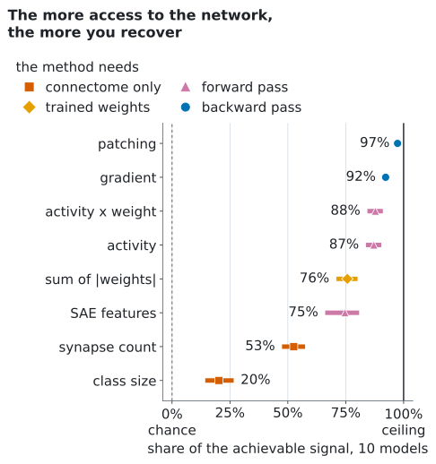
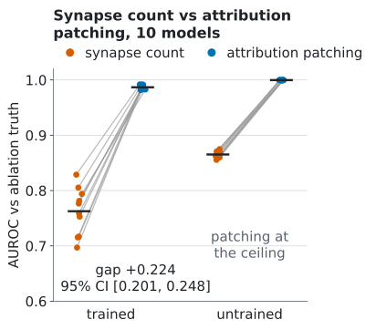
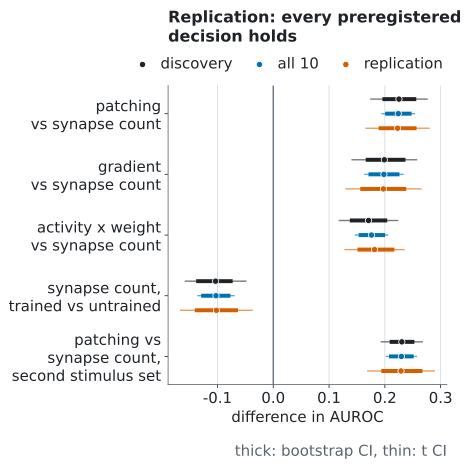

<h1 align="center">flyvis-circuit-bench</h1>

<p align="center"><b>Ile z tego, na czym opiera się obwód neuronowy, da się odczytać ze schematu połączeń?
Benchmark metod odkrywania obwodów względem dokładnej prawdy z ablacji w modelu układu wzrokowego muchy
ograniczonym konektomem.</b></p>

<p align="center">
  <a href="../../actions/workflows/ci.yml"></a>
  <a href="LICENSE"></a>
  <a href="LICENSE-data"></a>
  
  <a href="https://colab.research.google.com/github/natiixnt/flyvis-circuit-bench/blob/main/notebooks/score_your_method.ipynb"></a>
</p>

<p align="center">
  <picture>
    <source media="(prefers-color-scheme: dark)" srcset="docs/figures/hero-dark.svg">
    
  </picture>
</p>

English: [README.md](README.md). Liczby zapisujemy z kropką dziesiętną, jak w wersji angielskiej, w tabelach
(generowanych z wyników, po angielsku) i na wykresach.

## W skrócie

Wyłączaliśmy po kolei każdą z 604 klas połączeń typ komórki do typu komórki w 10 wytrenowanych modelach układu
wzrokowego muchy ([flyvis](https://github.com/TuragaLab/flyvis), Lappalainen i in., Nature 2024) i mierzyliśmy,
jak bardzo zmienia się odpowiedź sieci. To jest prawda. Attribution patching, który szacuje ten sam efekt z
gradientów, jest punktem odniesienia: odzyskuje **97%** osiągalnego sygnału (AUROC 0.987). Pytanie brzmi, ile
daje sama anatomia.

- **Sama anatomia odzyskuje mniej więcej połowę.** Ranking połączeń według liczby synaps odzyskuje 53%
  osiągalnego sygnału (AUROC 0.763); liczba synaps umieszcza 17 z 61 najważniejszych połączeń we własnych
  górnych 61 (precision@61, metryka dodana po prerejestracji).
- **Jeden wyuczony skalar na klasę połączeń domyka mniej więcej połowę pozostałej luki.** We flyvis waga to
  liczba synaps razy jedna wytrenowana siła na klasę; ranking według sumy |wag| odzyskuje 76% (AUROC 0.878),
  czyli 49% luki, którą zostawia liczba synaps.
- **Jedno przejście wstecz daje prawie wszystko.** Pojedynczy gradient osiąga 92% (AUROC 0.961), wobec 97% dla
  patchingu z 32 przejściami wstecz.
- **Ten SAE nie bije zwykłej sumy wag.** Cechy jedynego rzadkiego autoenkodera, którego dopasowaliśmy, osiągają
  AUROC 0.873, zwykła suma |wag| 0.878.
- **Obalone: trening zmniejsza przewagę patchingu nad anatomią, a nie ją zwiększa.** Na Spearmanie wewnątrz
  górnych 61, jedynej mierze, która nie nasyca się w sieciach niewytrenowanych, przewaga w sieciach
  wytrenowanych minus przewaga w niewytrenowanych wynosi -0.705.

Wszystkie cztery decyzje spisane przed replikacją utrzymały się na 5 modelach analizowanych dopiero potem i na
drugim zestawie bodźców. Masz metodę, która szereguje połączenia? [Oceń ją](#dodaj-swoją-metodę) w kilka minut,
bez GPU, jeśli korzysta z konektomu i wag; metody oparte na aktywacjach i gradientach potrzebują flyvis i torch.

## Dlaczego to ważne

- **Konektomy już są; które połączenia są ważne, wciąż nie wiadomo.** Istnieją pełne konektomy muchy. Ten
  benchmark mierzy, jak daleko sama anatomia pozwala przewidzieć, na których połączeniach opiera się
  wytrenowana sieć, względem prawdy liczonej dokładnie, a nie zgadywanej.
- **Poligon dla metod interpretowalności ze znaną odpowiedzią.** Patching, gradienty, miary oparte na aktywności
  i ten SAE są porównane na tych samych zasadach co anatomia, ze zmierzonym sufitem prawdy, więc każdy wynik da
  się czytać jako udział w tym, co osiągalne.

## Ranking (leaderboard)

Sieci wytrenowane, 10 modeli. Discovery = modele 000-004, analizowane najpierw; replication = modele 005-009,
analizowane po spisaniu reguł. AUROC to prerejestrowana metryka główna; udział sygnału, AUPRC i precision@61
dodaliśmy po prerejestracji i nie zmieniają żadnej decyzji.

| method | needs | AUROC [95% CI] | share of signal | discovery | replication | AUPRC | precision@61 |
|---|---|---|---|---|---|---|---|
| attribution patching | 32 backward passes | 0.987 [0.985, 0.989] | 97% | 0.987 | 0.987 | 0.889 | 0.816 |
| gradient | 1 backward pass | 0.961 [0.955, 0.967] | 92% | 0.961 | 0.961 | 0.804 | 0.715 |
| activity x weight | forward pass | 0.939 [0.922, 0.955] | 88% | 0.932 | 0.945 | 0.667 | 0.608 |
| activity | forward pass | 0.936 [0.918, 0.952] | 87% | 0.929 | 0.942 | 0.651 | 0.598 |
| sum of \|weights\| | trained weights | 0.878 [0.855, 0.900] | 76% | 0.879 | 0.878 | 0.414 | 0.428 |
| SAE features | forward pass + SAE fit | 0.873 [0.831, 0.904] | 75% | 0.859 | 0.888 | 0.488 | 0.474 |
| synapse count | connectome only | 0.763 [0.737, 0.787] | 53% | 0.762 | 0.764 | 0.248 | 0.284 |
| class size | connectome only | 0.601 [0.572, 0.633] | 20% | 0.599 | 0.603 | 0.150 | 0.187 |
| truth ceiling | 604 ablations | 1.000 [0.999, 1.000] | 100% | 1.000 | 1.000 | 0.998 | 0.974 |

AUROC mierzy, jak dobrze ranking 604 klas według metody oddziela górne 10% według efektu ablacji (61 klas).
Udział sygnału (share of signal) = (AUROC - 0.5) / (sufit - 0.5) w każdym modelu: 0% to przypadek, 100% to
zgodność prawdy samej ze sobą między dwiema połowami bodźców. Przewaga patchingu nad liczbą synaps wynosi 0.224, 95% CI [0.201, 0.248]
(bootstrap) i [0.195, 0.253] (t-Studenta), dodatnia w 10 z 10 modeli; na samych modelach discovery było to 0.225
[0.196, 0.256] i [0.175, 0.276]. Wszystkie przedziały, wartości modeli, sieci niewytrenowane i drugi zestaw
bodźców: [docs/results.md](docs/results.md).

**Zgłoszenia.** Otwórz pull request, który dodaje Twój wiersz (wynik `fcb score`) i link do kodu tworzącego
plik z wynikami; [szablon pull requesta](.github/pull_request_template.md) wymienia, co sprawdzamy. Szczegóły w
[CONTRIBUTING.md](CONTRIBUTING.md#add-a-method-to-the-leaderboard).

<p align="center">
  <picture>
    <source media="(prefers-color-scheme: dark)" srcset="docs/figures/per-model-dark.svg">
    
  </picture>
  <picture>
    <source media="(prefers-color-scheme: dark)" srcset="docs/figures/replication-dark.svg">
    
  </picture>
</p>

Anatomia przewiduje sieci niewytrenowane lepiej niż wytrenowane (AUROC liczby synaps 0.865 wobec 0.763), bo
flyvis ustawia na starcie siłę każdej klasy z konektomu (suma wag = 0.01 x liczba krawędzi), więc przed treningiem
każda waga jest stałą funkcją anatomii; trening odsuwa siły od niej.

## Szybki start

Same wyniki, bez GPU, około minuty na laptopie (potrzebny [uv](https://docs.astral.sh/uv/)):

```bash
git clone https://github.com/natiixnt/flyvis-circuit-bench && cd flyvis-circuit-bench
uv run fcb download                      # paczka pomiarów 38.5 MB, sprawdzana sha256
uv run fcb reproduce --data data/measurements-v1.0.0 --check
```

`reproduce` przelicza każdą tabelę w [docs/results.md](docs/results.md) i
[results/results.json](results/results.json) z plików pomiarów i sprawdza zgodność bajt w bajt.
`uv run fcb figures` rysuje wykresy od nowa. Powtórzenie samych pomiarów (`fcb measure`: prawda i każda metoda
z rankingu) wymaga flyvis i torch (`uv sync --extra measure`), zob.
[docs/methodology.md](docs/methodology.md#re-measuring).

## Dodaj swoją metodę

Metoda to cokolwiek, co daje każdej z 604 klas połączeń wynik (większy = ważniejsza), bez patrzenia na ablacje.
Po szybkim starcie:

```python
import numpy as np
from flyvis_circuit_bench import score

DATA = "data/measurements-v1.0.0"
inputs = score.method_inputs(DATA)  # dla modelu: typy komórek, liczby synaps, wagi, krawędzie; bez prawdy

def my_method(x):  # jeden wynik na klasę połączeń
    return x["sum_abs_weight"] / x["n_edges"]  # średnia |waga| na krawędź

np.savez("my_method.npz", **{model: my_method(x) for model, x in inputs.items()})
```

```bash
uv run fcb score --data data/measurements-v1.0.0 --scores my_method.npz --name "mean |weight| per edge"
# scores 0.827 AUROC
```

`fcb score` wypisuje wiersz w formacie [rankingu](#ranking-leaderboard): AUROC z 95% CI po 10 modelach, udział
sygnału, AUROC na modelach discovery i replication, AUPRC i precision@61 (ile z 61 najważniejszych połączeń jest
w Twoich górnych 61). Pola, które daje `method_inputs`, opisuje
[docs/methodology.md](docs/methodology.md#method-inputs). Metody oparte na konektomie i wagach liczą się w kilka
minut bez GPU; metody, które potrzebują aktywacji albo gradientów, ładują modele flyvis po
`uv sync --extra measure` (flyvis i torch). To samo w notatniku:
[notebooks/score_your_method.ipynb](notebooks/score_your_method.ipynb)
([otwórz w Colab](https://colab.research.google.com/github/natiixnt/flyvis-circuit-bench/blob/main/notebooks/score_your_method.ipynb)).

## Jak to działa

1. **Prawda z ablacji.** Dla każdej z 604 klas połączeń (wszystkie synapsy od jednego typu komórki do drugiego)
   ustawiamy jej skalę synaptyczną na 0 i zapisujemy odpowiedź r centralnej kolumny każdego typu komórki na 40
   bodźców (24 przesuwające się krawędzie, 16 klipów z filmu Sintel). Efekt to
   E(e) = średnia po bodźcach z ||r_e - r||² / ||r||². Prawda binarna to górne 10% klas (61).
2. **Metody szeregują klasy bez wglądu w E.** Liczba synaps, suma |wag| i wielkość klasy korzystają tylko z
   konektomu i parametrów. Attribution patching to przybliżenie pierwszego rzędu tego samego efektu z 32 losowych
   kierunków wyjścia (32 przejścia wstecz zamiast 604 ablacji); gradient używa jednego kierunku. Aktywność razy
   waga, aktywność i ten SAE liczymy z aktywności na odłożonych bodźcach.
3. **Sieci.** 10 wytrenowanych modeli z opublikowanego zespołu flyvis i te same sieci po inicjalizacji flyvis
   (niewytrenowane). Miary: AUROC (główna), AUPRC, Spearman oraz Spearman wewnątrz górnych 61, który nie nasyca
   się, gdy AUROC wynosi 1.
4. **Statystyka.** Średnia po modelach z dwoma 95% przedziałami (bootstrap po modelach i t-Studenta); wynik
   liczy się tylko wtedy, gdy oba się zgadzają. Szczegóły w [docs/methodology.md](docs/methodology.md).

## Prace pokrewne

[FlyHack](https://arxiv.org/abs/2610.13018) (Dhawan, 2026) usuwa te same 604 klasy połączeń w tych samych
modelach flyvis 000-009 i ocenia względem tej prawdy integrated gradients i edge attribution patching;
wyczerpująca ablacja jako prawda nie jest tu nowością. Co dodaje ten benchmark: ile odzyskuje sama anatomia na
jednej skali udziału sygnału, drabinkę tanich przybliżeń (wagi, aktywność, ten SAE, gradient), sieci
wytrenowane kontra niewytrenowane z obaloną hipotezą i ranking. Odczyty i prawdy są różne (FlyHack: jedna
zdekodowana liczba przepływu optycznego na zachowanie, prawda = górne 20, średnia po 20 parach model x zachowanie;
tutaj: centralna kolumna każdego typu komórki, prawda = górne 61), więc patching z zerowaniem osiąga tam AUROC
0.927, a tutaj 0.987; wyniki się uzupełniają, a nie przeczą sobie. Benchmarki ze
znaną odpowiedzią w modelach językowych: [MIB](https://arxiv.org/abs/2504.13151) i
[InterpBench](https://arxiv.org/abs/2407.14494). Więcej, także Beiran i Litwin-Kumar o tym, dlaczego konektom
nie wyznacza dynamiki: [docs/related_work.md](docs/related_work.md).

## Odtwarzalność

- **Reguły przed danymi.** Każdą regułę decyzji spisaliśmy przed danymi, których dotyczy, a każdą późniejszą
  zmianę wymieniamy z datą i powodem. Historia z datami jest w prywatnym repozytorium. Publikujemy sumy sha256
  oryginalnych dokumentów: pozwalają każdemu sprawdzić dokumenty, gdy historia z datami zostanie udostępniona;
  zewnętrzny znacznik czasu (OSF) jest planowany. Zob. [docs/preregistration.md](docs/preregistration.md).
- **Odtworzenie bajt w bajt.** `fcb reproduce --check` przelicza `results/results.json` i `docs/results.md` i
  porównuje je bajt w bajt; CI sprawdza tę ścieżkę kodu na danych syntetycznych przy każdym pushu.
- **Sumy kontrolne.** Asset wydania ma `SHA256SUMS`; `fcb download` sprawdza archiwum i każdy plik w środku
  (sha256 archiwum `sha256:61d15c127b488eb96d0352d60e09f9f55349c91a2dac61dd90cfa236e53c1341`). Pliki pomiarów są
  bajtowo identyczne z tymi, z których policzono tabele badania.
- **Determinizm.** Stałe ziarna (bootstrap 20261101, losowe kierunki dla każdego bodźca), posortowana kolejność
  modeli, wykresy bez znaczników czasu. Użyliśmy dwóch urządzeń (Apple silicon dla modeli 000-004, CUDA dla
  005-009 i drugiego zestawu bodźców); zgodność między nimi sprawdziliśmy przed użyciem (zob.
  [docs/preregistration.md](docs/preregistration.md#deviations)).

## Wyniki negatywne i ograniczenia

- **Obalone: trening zmniejsza przewagę patchingu nad anatomią, a nie ją zwiększa.** Miara to Spearman wewnątrz
  górnych 61, jedyna, która nie nasyca się w sieciach niewytrenowanych: przewaga w sieciach wytrenowanych minus
  przewaga w niewytrenowanych wynosi **-0.705** [-0.752, -0.660 | t -0.779, -0.630]. Na AUROC przewaga wygląda
  po treningu na większą o 0.091 tylko dlatego, że patching dochodzi do sufitu w sieciach niewytrenowanych.
- **Jedyną prawdą jest zerowanie.** Patching to linearyzacja wyzerowania klasy, więc część jego 0.987 może brać
  się z dopasowania do interwencji, a nie z trafiania w to, co ważne; to benchmark metod względem ablacji, nie
  dowód „funkcji poza schematem połączeń”. Test odporności z ablacją do średniej planujemy jako osobne badanie.
- **Tanie przybliżenia nie są za darmo.** Gradient (jedno przejście wstecz) traci do patchingu 0.026 AUROC
  [-0.033, -0.019], 10 modeli. Ten SAE (0.873) nie bije zwykłej sumy |wag| (0.878); to jedna konfiguracja, nie
  rzadkie autoenkodery w ogóle.
- **„Niewytrenowana” nie znaczy „losowa”.** Inicjalizacja flyvis ustawia sumę wag każdej klasy na 0.01 x liczba
  jej krawędzi, więc sieci niewytrenowane już niosą strukturę liczby synaps (Spearman z liczbą synaps 0.662).
- **Sieć z przetasowanymi wagami jest nieustalona.** Każdy prerejestrowany sposób permutowania wytrenowanych wag
  rozregulowywał dynamikę w 4 lub 5 z 5 modeli, więc nie ma dla niej prawdy z ablacji.
- **Jedna rodzina modeli.** Jeden zespół, 10 modeli, jeden odczyt (kolumny centralne), 40 + 24 bodźce; drugi
  zestaw bodźców nie ma naturalnych filmów. Wnioski dotyczą tego modelu, nie muszki. Pełna lista:
  [docs/limitations.md](docs/limitations.md).

## Plan

- **Druga rodzina modeli.** Jeden wytrenowany zespół to najsłabszy punkt v1.0.0. Następny krok: model z
  neuronami typu leaky integrate-and-fire zbudowany z całego konektomu FlyWire (Shiu i in., Nature 2024), z tą
  samą prawdą z ablacji i tym samym rankingiem.
- **Odporność na rodzaj interwencji:** prawda policzona od nowa z ablacją do średniej zamiast zerowania i
  ponowna ocena każdej metody (osobne badanie, wyniki w v1.1).
- **Zewnętrzny znacznik czasu** dla reguł następnego badania (OSF), zanim powstaną dane, i DOI z Zenodo dla
  wydania.
- **Kod pomiaru drugiego zestawu bodźców** (przesuwane paski). v1.0.0 zawiera kod pomiaru prawdy i każdej metody
  z rankingu (`fcb measure --what all`); drugi zestaw bodźców jest tylko w paczce.
- **Twoja metoda.** Pull requesty z nowymi wierszami są mile widziane, zob. [Dodaj swoją metodę](#dodaj-swoją-metodę).

## Układ repozytorium

```
src/flyvis_circuit_bench/   metryki, statystyka, analiza, ocena metod, raport, wykresy, CLI, pobieranie
src/.../measure/            opcjonalna ścieżka pomiaru (flyvis + torch)
results/results.json        wszystkie liczby w formie maszynowej
notebooks/                  ocena własnej metody (działa w Colab)
docs/                       metodologia, prerejestracja, wyniki, ograniczenia, prace pokrewne, dane, wykresy
tests/                      testy jednostkowe, testy end-to-end na danych syntetycznych, kontrola bajtowa na danych
```

## Cytowanie

Jeśli korzystasz z benchmarku, pomiarów albo kodu, prosimy o cytowanie (zob. też [CITATION.cff](CITATION.cff)):

```bibtex
@software{szczepanik_2026_flyvis_circuit_bench,
  author  = {Szczepanik, Natalia},
  title   = {flyvis-circuit-bench: a benchmark of circuit-discovery methods
             against ablation ground truth in the flyvis connectome model},
  year    = {2026},
  version = {1.0.0},
  url     = {https://github.com/natiixnt/flyvis-circuit-bench}
}
```

DOI (Zenodo) dodamy w następnym wydaniu. Prosimy też o cytowanie flyvis: Lappalainen, J. K. i in.
Connectome-constrained networks predict neural activity across the fly visual system. *Nature* 634, 1132-1140
(2024). https://doi.org/10.1038/s41586-024-07939-3

## Licencja

Kod: [MIT](LICENSE). Pomiary, tabele wyników, wykresy i dokumentacja: [CC BY 4.0](LICENSE-data). Wkład mile
widziany, zob. [CONTRIBUTING.md](CONTRIBUTING.md) i [Kodeks postępowania](CODE_OF_CONDUCT.md).
