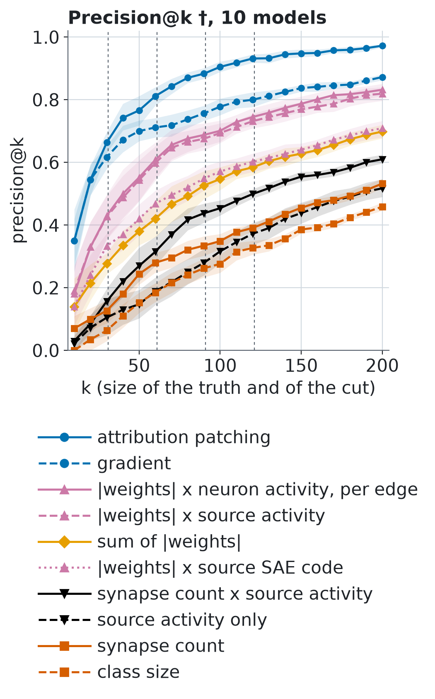

# Z1 †: sensitivity to the threshold, continuous metrics

† Added after the study, exploratory, defined in `analysis-plan-v1.1.md` before it was run. It changes no preregistered decision. Mean over models with 95% bootstrap interval over models, seed 20261101; truth = the top-k classes by E (ties at the cut included).

**Conclusion †.** Across the four thresholds 0 swap(s) and 3 not-separated sign change(s) occur among 45 method pairs (all 10 models), shares of signal stay within 0.14 to 0.99, and the highest Spearman with E is 1.00 (attribution patching).

## Thresholds, all 10 models †

### AUROC †

| method | top 31 | top 61 | top 91 | top 121 |
|---|---|---|---|---|
| truth ceiling † | 1.000 [1.000, 1.000] | 1.000 [0.999, 1.000] | 1.000 [1.000, 1.000] | 1.000 [1.000, 1.000] |
| attribution patching † | 0.982 [0.978, 0.985] | 0.987 [0.985, 0.989] | 0.992 [0.990, 0.994] | 0.994 [0.993, 0.996] |
| gradient † | 0.960 [0.950, 0.969] | 0.961 [0.955, 0.967] | 0.964 [0.958, 0.969] | 0.968 [0.963, 0.973] |
| |weights| x neuron activity, per edge † | 0.932 [0.909, 0.952] | 0.939 [0.922, 0.955] | 0.948 [0.935, 0.960] | 0.952 [0.941, 0.962] |
| |weights| x source activity † | 0.928 [0.905, 0.950] | 0.936 [0.918, 0.952] | 0.943 [0.930, 0.955] | 0.945 [0.936, 0.955] |
| sum of |weights| † | 0.872 [0.841, 0.901] | 0.878 [0.855, 0.900] | 0.879 [0.859, 0.898] | 0.876 [0.862, 0.890] |
| |weights| x source SAE code † | 0.865 [0.826, 0.897] | 0.873 [0.831, 0.904] | 0.878 [0.843, 0.904] | 0.877 [0.841, 0.901] |
| synapse count x source activity † | 0.822 [0.805, 0.843] | 0.833 [0.813, 0.854] | 0.832 [0.819, 0.847] | 0.825 [0.814, 0.836] |
| source activity only † | 0.717 [0.696, 0.741] | 0.715 [0.687, 0.744] | 0.720 [0.698, 0.741] | 0.720 [0.701, 0.737] |
| synapse count † | 0.745 [0.719, 0.770] | 0.763 [0.737, 0.787] | 0.758 [0.738, 0.779] | 0.749 [0.731, 0.765] |
| class size † | 0.570 [0.531, 0.620] | 0.601 [0.572, 0.633] | 0.618 [0.591, 0.644] | 0.623 [0.606, 0.639] |

### share of signal (ceiling per threshold) †

| method | top 31 | top 61 | top 91 | top 121 |
|---|---|---|---|---|
| attribution patching † | 0.964 [0.957, 0.971] | 0.974 [0.970, 0.978] | 0.984 [0.980, 0.988] | 0.989 [0.986, 0.992] |
| gradient † | 0.920 [0.901, 0.939] | 0.922 [0.910, 0.934] | 0.928 [0.917, 0.938] | 0.937 [0.927, 0.947] |
| |weights| x neuron activity, per edge † | 0.864 [0.819, 0.905] | 0.878 [0.844, 0.910] | 0.896 [0.870, 0.921] | 0.904 [0.882, 0.925] |
| |weights| x source activity † | 0.857 [0.810, 0.899] | 0.872 [0.837, 0.904] | 0.886 [0.861, 0.910] | 0.891 [0.873, 0.910] |
| sum of |weights| † | 0.745 [0.682, 0.801] | 0.757 [0.709, 0.801] | 0.758 [0.718, 0.797] | 0.752 [0.724, 0.780] |
| |weights| x source SAE code † | 0.730 [0.653, 0.795] | 0.747 [0.661, 0.808] | 0.757 [0.686, 0.808] | 0.754 [0.682, 0.802] |
| synapse count x source activity † | 0.645 [0.609, 0.686] | 0.666 [0.627, 0.707] | 0.665 [0.638, 0.694] | 0.650 [0.629, 0.672] |
| source activity only † | 0.435 [0.391, 0.482] | 0.430 [0.374, 0.488] | 0.441 [0.397, 0.483] | 0.440 [0.402, 0.475] |
| synapse count † | 0.491 [0.438, 0.541] | 0.526 [0.475, 0.574] | 0.516 [0.477, 0.559] | 0.497 [0.463, 0.530] |
| class size † | 0.141 [0.063, 0.240] | 0.202 [0.143, 0.266] | 0.236 [0.182, 0.288] | 0.246 [0.213, 0.278] |

### AUPRC †

| method | top 31 | top 61 | top 91 | top 121 |
|---|---|---|---|---|
| attribution patching † | 0.753 [0.724, 0.783] | 0.889 [0.870, 0.908] | 0.952 [0.939, 0.966] | 0.978 [0.972, 0.985] |
| gradient † | 0.696 [0.659, 0.735] | 0.804 [0.779, 0.829] | 0.862 [0.843, 0.881] | 0.908 [0.895, 0.921] |
| |weights| x neuron activity, per edge † | 0.469 [0.380, 0.550] | 0.667 [0.589, 0.738] | 0.796 [0.746, 0.841] | 0.855 [0.826, 0.884] |
| |weights| x source activity † | 0.459 [0.373, 0.535] | 0.651 [0.574, 0.718] | 0.775 [0.725, 0.821] | 0.832 [0.806, 0.858] |
| sum of |weights| † | 0.272 [0.224, 0.315] | 0.414 [0.359, 0.466] | 0.524 [0.477, 0.574] | 0.594 [0.563, 0.625] |
| |weights| x source SAE code † | 0.307 [0.263, 0.342] | 0.488 [0.437, 0.532] | 0.595 [0.550, 0.636] | 0.656 [0.620, 0.690] |
| synapse count x source activity † | 0.179 [0.156, 0.205] | 0.314 [0.279, 0.352] | 0.421 [0.384, 0.461] | 0.494 [0.467, 0.524] |
| source activity only † | 0.112 [0.096, 0.130] | 0.200 [0.177, 0.223] | 0.278 [0.256, 0.302] | 0.351 [0.329, 0.375] |
| synapse count † | 0.142 [0.118, 0.169] | 0.248 [0.221, 0.274] | 0.337 [0.305, 0.371] | 0.405 [0.379, 0.431] |
| class size † | 0.073 [0.061, 0.090] | 0.150 [0.132, 0.169] | 0.226 [0.205, 0.247] | 0.295 [0.280, 0.311] |

### precision@k, k = threshold †

| method | top 31 | top 61 | top 91 | top 121 |
|---|---|---|---|---|
| attribution patching † | 0.684 [0.648, 0.719] | 0.816 [0.790, 0.843] | 0.886 [0.869, 0.903] | 0.931 [0.917, 0.945] |
| gradient † | 0.639 [0.603, 0.674] | 0.715 [0.682, 0.746] | 0.760 [0.737, 0.782] | 0.802 [0.781, 0.824] |
| |weights| x neuron activity, per edge † | 0.442 [0.365, 0.513] | 0.608 [0.551, 0.662] | 0.690 [0.653, 0.727] | 0.745 [0.717, 0.776] |
| |weights| x source activity † | 0.435 [0.364, 0.500] | 0.598 [0.544, 0.648] | 0.677 [0.641, 0.715] | 0.732 [0.709, 0.756] |
| sum of |weights| † | 0.294 [0.252, 0.335] | 0.428 [0.372, 0.482] | 0.530 [0.485, 0.576] | 0.587 [0.562, 0.611] |
| |weights| x source SAE code † | 0.335 [0.290, 0.381] | 0.474 [0.425, 0.516] | 0.549 [0.512, 0.587] | 0.603 [0.570, 0.631] |
| synapse count x source activity † | 0.158 [0.119, 0.203] | 0.316 [0.275, 0.361] | 0.441 [0.409, 0.475] | 0.501 [0.487, 0.517] |
| source activity only † | 0.105 [0.051, 0.163] | 0.190 [0.145, 0.235] | 0.283 [0.243, 0.328] | 0.374 [0.339, 0.409] |
| synapse count † | 0.132 [0.097, 0.168] | 0.284 [0.254, 0.313] | 0.338 [0.304, 0.369] | 0.392 [0.381, 0.404] |
| class size † | 0.065 [0.029, 0.110] | 0.187 [0.159, 0.215] | 0.263 [0.234, 0.293] | 0.329 [0.308, 0.350] |

### Spearman with E, all 604 classes †

| method | all 10 models | discovery | replication |
|---|---|---|---|
| attribution patching † | 0.996 [0.995, 0.997] | 0.996 [0.995, 0.997] | 0.996 [0.995, 0.997] |
| gradient † | 0.960 [0.956, 0.963] | 0.962 [0.957, 0.966] | 0.957 [0.952, 0.963] |
| |weights| x neuron activity, per edge † | 0.945 [0.935, 0.954] | 0.943 [0.927, 0.960] | 0.946 [0.936, 0.956] |
| |weights| x source activity † | 0.922 [0.908, 0.937] | 0.911 [0.893, 0.930] | 0.934 [0.915, 0.947] |
| sum of |weights| † | 0.837 [0.819, 0.855] | 0.843 [0.823, 0.863] | 0.831 [0.803, 0.860] |
| |weights| x source SAE code † | 0.812 [0.736, 0.860] | 0.772 [0.635, 0.861] | 0.852 [0.826, 0.874] |
| synapse count x source activity † | 0.486 [0.460, 0.510] | 0.467 [0.434, 0.505] | 0.504 [0.473, 0.528] |
| source activity only † | 0.346 [0.306, 0.384] | 0.312 [0.274, 0.350] | 0.379 [0.316, 0.418] |
| synapse count † | 0.360 [0.336, 0.381] | 0.363 [0.320, 0.395] | 0.356 [0.331, 0.379] |
| class size † | 0.222 [0.207, 0.239] | 0.229 [0.203, 0.257] | 0.216 [0.200, 0.230] |

## Thresholds, discovery (000-004) †

### AUROC †

| method | top 31 | top 61 | top 91 | top 121 |
|---|---|---|---|---|
| truth ceiling † | 1.000 [1.000, 1.000] | 1.000 [0.999, 1.000] | 1.000 [0.999, 1.000] | 1.000 [0.999, 1.000] |
| attribution patching † | 0.979 [0.974, 0.984] | 0.987 [0.983, 0.991] | 0.992 [0.989, 0.995] | 0.995 [0.993, 0.997] |
| gradient † | 0.955 [0.940, 0.967] | 0.961 [0.951, 0.970] | 0.965 [0.959, 0.970] | 0.969 [0.966, 0.973] |
| |weights| x neuron activity, per edge † | 0.929 [0.897, 0.959] | 0.932 [0.906, 0.959] | 0.940 [0.922, 0.959] | 0.947 [0.930, 0.965] |
| |weights| x source activity † | 0.925 [0.890, 0.956] | 0.929 [0.903, 0.956] | 0.935 [0.918, 0.952] | 0.940 [0.928, 0.954] |
| sum of |weights| † | 0.877 [0.837, 0.917] | 0.879 [0.852, 0.906] | 0.872 [0.849, 0.893] | 0.880 [0.863, 0.896] |
| |weights| x source SAE code † | 0.852 [0.783, 0.912] | 0.859 [0.778, 0.916] | 0.860 [0.798, 0.904] | 0.859 [0.792, 0.901] |
| synapse count x source activity † | 0.825 [0.794, 0.864] | 0.827 [0.798, 0.863] | 0.825 [0.809, 0.846] | 0.819 [0.805, 0.834] |
| source activity only † | 0.702 [0.682, 0.728] | 0.704 [0.675, 0.736] | 0.721 [0.695, 0.746] | 0.709 [0.686, 0.723] |
| synapse count † | 0.759 [0.727, 0.792] | 0.762 [0.728, 0.793] | 0.748 [0.725, 0.771] | 0.750 [0.733, 0.767] |
| class size † | 0.593 [0.528, 0.678] | 0.599 [0.547, 0.663] | 0.611 [0.567, 0.657] | 0.622 [0.592, 0.649] |

### share of signal (ceiling per threshold) †

| method | top 31 | top 61 | top 91 | top 121 |
|---|---|---|---|---|
| attribution patching † | 0.959 [0.949, 0.968] | 0.974 [0.967, 0.981] | 0.984 [0.977, 0.990] | 0.990 [0.986, 0.994] |
| gradient † | 0.909 [0.881, 0.934] | 0.922 [0.902, 0.940] | 0.930 [0.920, 0.941] | 0.939 [0.932, 0.947] |
| |weights| x neuron activity, per edge † | 0.858 [0.794, 0.919] | 0.865 [0.812, 0.918] | 0.881 [0.844, 0.919] | 0.895 [0.859, 0.931] |
| |weights| x source activity † | 0.850 [0.780, 0.912] | 0.860 [0.807, 0.912] | 0.870 [0.836, 0.904] | 0.881 [0.855, 0.908] |
| sum of |weights| † | 0.754 [0.675, 0.834] | 0.759 [0.704, 0.813] | 0.744 [0.698, 0.787] | 0.760 [0.726, 0.793] |
| |weights| x source SAE code † | 0.704 [0.566, 0.824] | 0.718 [0.556, 0.834] | 0.721 [0.596, 0.809] | 0.718 [0.584, 0.803] |
| synapse count x source activity † | 0.650 [0.587, 0.728] | 0.654 [0.596, 0.725] | 0.651 [0.618, 0.693] | 0.638 [0.610, 0.669] |
| source activity only † | 0.404 [0.365, 0.455] | 0.407 [0.350, 0.473] | 0.442 [0.391, 0.492] | 0.418 [0.372, 0.445] |
| synapse count † | 0.519 [0.454, 0.585] | 0.524 [0.455, 0.586] | 0.496 [0.449, 0.543] | 0.500 [0.466, 0.535] |
| class size † | 0.186 [0.057, 0.357] | 0.198 [0.095, 0.326] | 0.223 [0.134, 0.313] | 0.244 [0.185, 0.299] |

### AUPRC †

| method | top 31 | top 61 | top 91 | top 121 |
|---|---|---|---|---|
| attribution patching † | 0.719 [0.691, 0.746] | 0.880 [0.849, 0.910] | 0.948 [0.925, 0.970] | 0.978 [0.971, 0.987] |
| gradient † | 0.649 [0.617, 0.683] | 0.789 [0.751, 0.833] | 0.860 [0.839, 0.881] | 0.908 [0.895, 0.919] |
| |weights| x neuron activity, per edge † | 0.455 [0.320, 0.579] | 0.650 [0.519, 0.781] | 0.767 [0.692, 0.842] | 0.842 [0.797, 0.892] |
| |weights| x source activity † | 0.441 [0.303, 0.553] | 0.627 [0.492, 0.747] | 0.737 [0.667, 0.806] | 0.809 [0.777, 0.846] |
| sum of |weights| † | 0.292 [0.212, 0.352] | 0.422 [0.355, 0.482] | 0.501 [0.455, 0.557] | 0.593 [0.557, 0.628] |
| |weights| x source SAE code † | 0.299 [0.221, 0.358] | 0.481 [0.385, 0.566] | 0.562 [0.500, 0.625] | 0.625 [0.578, 0.671] |
| synapse count x source activity † | 0.173 [0.149, 0.212] | 0.297 [0.250, 0.366] | 0.399 [0.348, 0.461] | 0.483 [0.442, 0.534] |
| source activity only † | 0.104 [0.085, 0.127] | 0.190 [0.163, 0.222] | 0.274 [0.245, 0.312] | 0.329 [0.307, 0.356] |
| synapse count † | 0.128 [0.104, 0.161] | 0.236 [0.203, 0.274] | 0.312 [0.275, 0.350] | 0.397 [0.360, 0.435] |
| class size † | 0.081 [0.061, 0.112] | 0.154 [0.123, 0.191] | 0.219 [0.194, 0.244] | 0.295 [0.275, 0.313] |

### precision@k, k = threshold †

| method | top 31 | top 61 | top 91 | top 121 |
|---|---|---|---|---|
| attribution patching † | 0.677 [0.639, 0.716] | 0.816 [0.770, 0.862] | 0.888 [0.862, 0.919] | 0.931 [0.911, 0.950] |
| gradient † | 0.606 [0.568, 0.652] | 0.711 [0.656, 0.764] | 0.763 [0.732, 0.785] | 0.797 [0.775, 0.818] |
| |weights| x neuron activity, per edge † | 0.419 [0.303, 0.523] | 0.600 [0.505, 0.695] | 0.675 [0.626, 0.723] | 0.740 [0.693, 0.793] |
| |weights| x source activity † | 0.406 [0.290, 0.497] | 0.587 [0.498, 0.675] | 0.657 [0.613, 0.701] | 0.722 [0.689, 0.755] |
| sum of |weights| † | 0.316 [0.252, 0.374] | 0.436 [0.354, 0.502] | 0.510 [0.455, 0.565] | 0.582 [0.547, 0.612] |
| |weights| x source SAE code † | 0.329 [0.252, 0.400] | 0.466 [0.380, 0.544] | 0.527 [0.473, 0.582] | 0.587 [0.527, 0.636] |
| synapse count x source activity † | 0.129 [0.084, 0.174] | 0.285 [0.233, 0.367] | 0.418 [0.376, 0.475] | 0.498 [0.479, 0.519] |
| source activity only † | 0.082 [0.030, 0.140] | 0.158 [0.107, 0.220] | 0.283 [0.230, 0.362] | 0.347 [0.321, 0.385] |
| synapse count † | 0.123 [0.058, 0.187] | 0.285 [0.243, 0.328] | 0.321 [0.266, 0.365] | 0.392 [0.377, 0.407] |
| class size † | 0.084 [0.039, 0.155] | 0.184 [0.138, 0.233] | 0.240 [0.206, 0.274] | 0.317 [0.288, 0.349] |

## Thresholds, replication (005-009) †

### AUROC †

| method | top 31 | top 61 | top 91 | top 121 |
|---|---|---|---|---|
| truth ceiling † | 1.000 [1.000, 1.000] | 1.000 [1.000, 1.000] | 1.000 [1.000, 1.000] | 1.000 [1.000, 1.000] |
| attribution patching † | 0.984 [0.981, 0.988] | 0.987 [0.984, 0.989] | 0.992 [0.989, 0.994] | 0.994 [0.992, 0.997] |
| gradient † | 0.965 [0.954, 0.978] | 0.961 [0.953, 0.969] | 0.963 [0.953, 0.972] | 0.968 [0.959, 0.977] |
| |weights| x neuron activity, per edge † | 0.935 [0.904, 0.961] | 0.945 [0.926, 0.962] | 0.955 [0.941, 0.969] | 0.956 [0.946, 0.965] |
| |weights| x source activity † | 0.932 [0.899, 0.959] | 0.942 [0.922, 0.959] | 0.951 [0.935, 0.966] | 0.950 [0.939, 0.962] |
| sum of |weights| † | 0.868 [0.822, 0.903] | 0.878 [0.840, 0.913] | 0.886 [0.852, 0.915] | 0.872 [0.851, 0.894] |
| |weights| x source SAE code † | 0.878 [0.851, 0.905] | 0.888 [0.870, 0.905] | 0.896 [0.879, 0.914] | 0.895 [0.879, 0.909] |
| synapse count x source activity † | 0.820 [0.803, 0.834] | 0.839 [0.818, 0.861] | 0.839 [0.822, 0.859] | 0.831 [0.817, 0.845] |
| source activity only † | 0.732 [0.698, 0.767] | 0.727 [0.682, 0.771] | 0.720 [0.684, 0.753] | 0.731 [0.699, 0.756] |
| synapse count † | 0.731 [0.695, 0.767] | 0.764 [0.728, 0.799] | 0.768 [0.738, 0.799] | 0.747 [0.717, 0.774] |
| class size † | 0.548 [0.509, 0.589] | 0.603 [0.580, 0.627] | 0.624 [0.596, 0.653] | 0.624 [0.609, 0.640] |

### share of signal (ceiling per threshold) †

| method | top 31 | top 61 | top 91 | top 121 |
|---|---|---|---|---|
| attribution patching † | 0.969 [0.961, 0.976] | 0.973 [0.969, 0.979] | 0.984 [0.978, 0.989] | 0.989 [0.984, 0.994] |
| gradient † | 0.931 [0.909, 0.956] | 0.923 [0.907, 0.939] | 0.925 [0.907, 0.944] | 0.936 [0.918, 0.954] |
| |weights| x neuron activity, per edge † | 0.869 [0.808, 0.922] | 0.891 [0.852, 0.925] | 0.911 [0.882, 0.938] | 0.912 [0.892, 0.931] |
| |weights| x source activity † | 0.863 [0.799, 0.918] | 0.883 [0.844, 0.918] | 0.901 [0.871, 0.932] | 0.901 [0.878, 0.924] |
| sum of |weights| † | 0.735 [0.644, 0.807] | 0.755 [0.681, 0.827] | 0.772 [0.705, 0.830] | 0.745 [0.701, 0.788] |
| |weights| x source SAE code † | 0.757 [0.702, 0.810] | 0.776 [0.741, 0.811] | 0.793 [0.758, 0.828] | 0.791 [0.759, 0.819] |
| synapse count x source activity † | 0.640 [0.607, 0.668] | 0.679 [0.636, 0.722] | 0.679 [0.643, 0.718] | 0.663 [0.635, 0.690] |
| source activity only † | 0.465 [0.396, 0.534] | 0.453 [0.364, 0.543] | 0.440 [0.369, 0.507] | 0.462 [0.398, 0.512] |
| synapse count † | 0.463 [0.391, 0.535] | 0.528 [0.456, 0.599] | 0.537 [0.476, 0.598] | 0.494 [0.434, 0.549] |
| class size † | 0.095 [0.017, 0.177] | 0.206 [0.159, 0.255] | 0.249 [0.192, 0.306] | 0.249 [0.217, 0.280] |

### AUPRC †

| method | top 31 | top 61 | top 91 | top 121 |
|---|---|---|---|---|
| attribution patching † | 0.786 [0.762, 0.819] | 0.898 [0.876, 0.922] | 0.957 [0.943, 0.972] | 0.978 [0.969, 0.988] |
| gradient † | 0.742 [0.715, 0.782] | 0.818 [0.792, 0.844] | 0.864 [0.834, 0.895] | 0.907 [0.887, 0.931] |
| |weights| x neuron activity, per edge † | 0.483 [0.379, 0.586] | 0.684 [0.614, 0.752] | 0.825 [0.780, 0.868] | 0.868 [0.841, 0.896] |
| |weights| x source activity † | 0.476 [0.375, 0.574] | 0.675 [0.607, 0.738] | 0.814 [0.770, 0.857] | 0.855 [0.830, 0.880] |
| sum of |weights| † | 0.252 [0.198, 0.302] | 0.405 [0.318, 0.493] | 0.547 [0.470, 0.621] | 0.595 [0.540, 0.648] |
| |weights| x source SAE code † | 0.314 [0.271, 0.339] | 0.494 [0.463, 0.520] | 0.628 [0.589, 0.665] | 0.688 [0.657, 0.722] |
| synapse count x source activity † | 0.185 [0.153, 0.223] | 0.330 [0.293, 0.367] | 0.443 [0.399, 0.489] | 0.505 [0.477, 0.533] |
| source activity only † | 0.120 [0.094, 0.148] | 0.209 [0.173, 0.241] | 0.282 [0.253, 0.311] | 0.374 [0.345, 0.399] |
| synapse count † | 0.157 [0.121, 0.193] | 0.259 [0.221, 0.294] | 0.363 [0.320, 0.405] | 0.412 [0.379, 0.446] |
| class size † | 0.065 [0.057, 0.075] | 0.146 [0.131, 0.162] | 0.233 [0.201, 0.266] | 0.295 [0.272, 0.323] |

### precision@k, k = threshold †

| method | top 31 | top 61 | top 91 | top 121 |
|---|---|---|---|---|
| attribution patching † | 0.690 [0.632, 0.742] | 0.816 [0.790, 0.846] | 0.884 [0.866, 0.901] | 0.931 [0.912, 0.949] |
| gradient † | 0.671 [0.632, 0.710] | 0.718 [0.682, 0.751] | 0.758 [0.721, 0.798] | 0.808 [0.769, 0.845] |
| |weights| x neuron activity, per edge † | 0.465 [0.374, 0.555] | 0.616 [0.561, 0.672] | 0.705 [0.653, 0.758] | 0.750 [0.719, 0.782] |
| |weights| x source activity † | 0.465 [0.381, 0.542] | 0.610 [0.557, 0.662] | 0.697 [0.644, 0.749] | 0.742 [0.711, 0.774] |
| sum of |weights| † | 0.271 [0.219, 0.316] | 0.420 [0.338, 0.502] | 0.549 [0.481, 0.618] | 0.592 [0.554, 0.630] |
| |weights| x source SAE code † | 0.342 [0.290, 0.394] | 0.482 [0.446, 0.518] | 0.571 [0.527, 0.615] | 0.620 [0.600, 0.640] |
| synapse count x source activity † | 0.187 [0.135, 0.258] | 0.348 [0.315, 0.380] | 0.464 [0.437, 0.497] | 0.504 [0.486, 0.531] |
| source activity only † | 0.129 [0.035, 0.224] | 0.222 [0.157, 0.275] | 0.283 [0.233, 0.334] | 0.401 [0.343, 0.439] |
| synapse count † | 0.142 [0.116, 0.174] | 0.282 [0.239, 0.318] | 0.356 [0.321, 0.389] | 0.392 [0.377, 0.412] |
| class size † | 0.045 [0.006, 0.103] | 0.190 [0.157, 0.223] | 0.286 [0.250, 0.327] | 0.340 [0.321, 0.370] |

## Ordering changes †

A pair swaps when the sign of the mean AUROC difference differs between two thresholds and both 95% bootstrap intervals of the difference exclude zero; a sign change with an interval that includes zero at either threshold is listed as not separated.

### all 10 models †

Swapped pairs: 0.

Not separated: 3.

- sum of |weights| vs |weights| x source SAE code: AUROC difference 0.007 at top 31 [-0.019, 0.039], -0.001 at top 121 [-0.026, 0.032] †
- sum of |weights| vs |weights| x source SAE code: AUROC difference 0.005 at top 61 [-0.022, 0.038], -0.001 at top 121 [-0.026, 0.032] †
- sum of |weights| vs |weights| x source SAE code: AUROC difference 0.000 at top 91 [-0.022, 0.027], -0.001 at top 121 [-0.026, 0.032] †

### discovery (000-004) †

Swapped pairs: 0.

Not separated: 0.

### replication (005-009) †

Swapped pairs: 0.

Not separated: 3.

- source activity only vs synapse count: AUROC difference 0.001 at top 31 [-0.065, 0.068], -0.037 at top 61 [-0.113, 0.039] †
- source activity only vs synapse count: AUROC difference 0.001 at top 31 [-0.065, 0.068], -0.048 at top 91 [-0.108, 0.007] †
- source activity only vs synapse count: AUROC difference 0.001 at top 31 [-0.065, 0.068], -0.016 at top 121 [-0.073, 0.032] †

## Precision@k curve †

Mean precision@k over all 10 models for k = 10, ..., 200; the truth of each k is the top-k classes by E. Values per method and k, with intervals, are under `v1_1.z1.curve` in `results/results.json`.
