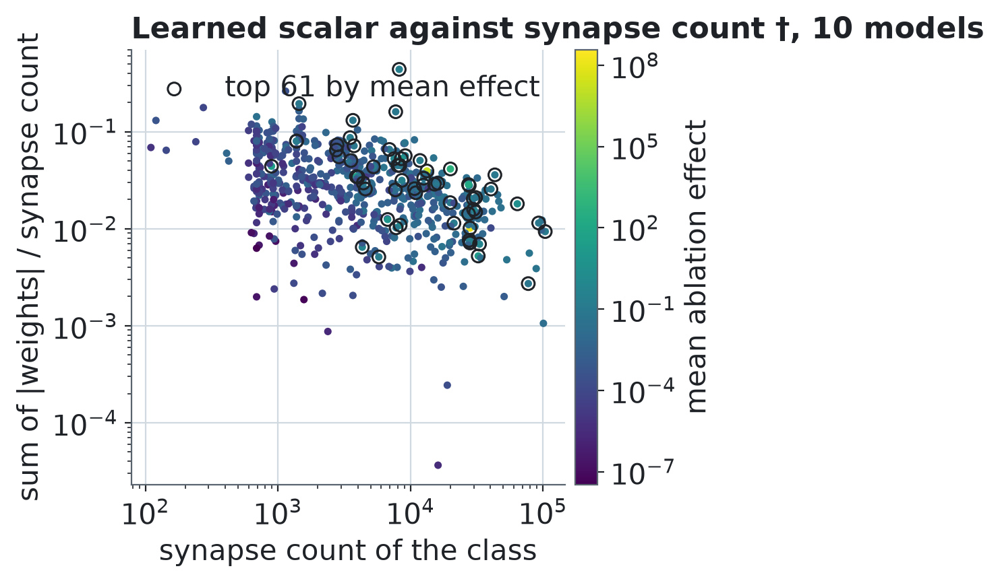

# Z3 †: agreement between models, variance of learned scalars

† Added after the study, exploratory, defined in `analysis-plan-v1.1.md` before it was run. It changes no preregistered decision. Pair statistics are over pairs of models (not independent, so no interval); the split-half uses the mean over models with a 95% bootstrap interval over models, seed 20261101.

**Conclusion †.** The median Spearman of E between models is 0.33 (split-half over stimuli inside a model: 1.00), the median top-61 overlap is 20 classes (Jaccard 0.20), 3 classes are core and 190 variable, and the Spearman between the CV of the scalar and the CV of the effect is 0.38.

## Agreement between models †

Top 61 = the top 10% of the 604 classes by E in each model (ties at the cut included). Cells are median (min to max) over pairs.

| pairs | n pairs | Spearman of E | top-61 overlap (classes) | Jaccard |
|---|---|---|---|---|
| all 10 models † | 45 | 0.334 (0.149 to 0.568) | 20 (10 to 34) | 0.196 (0.089 to 0.386) |
| discovery (000-004) † | 10 | 0.306 (0.179 to 0.426) | 18.5 (14 to 30) | 0.179 (0.130 to 0.326) |
| replication (005-009) † | 10 | 0.358 (0.266 to 0.475) | 23.5 (17 to 34) | 0.239 (0.162 to 0.386) |
| discovery x replication † | 25 | 0.333 (0.149 to 0.568) | 19 (10 to 33) | 0.184 (0.089 to 0.371) |

### Spearman of E between models †

| model | 000 | 001 | 002 | 003 | 004 | 005 | 006 | 007 | 008 | 009 |
|---|---|---|---|---|---|---|---|---|---|---|
| 000 | 1.000 | 0.179 | 0.218 | 0.220 | 0.334 | 0.242 | 0.202 | 0.192 | 0.149 | 0.219 |
| 001 | 0.179 | 1.000 | 0.417 | 0.426 | 0.292 | 0.300 | 0.400 | 0.328 | 0.336 | 0.382 |
| 002 | 0.218 | 0.417 | 1.000 | 0.401 | 0.320 | 0.364 | 0.568 | 0.333 | 0.489 | 0.487 |
| 003 | 0.220 | 0.426 | 0.401 | 1.000 | 0.250 | 0.338 | 0.432 | 0.236 | 0.386 | 0.419 |
| 004 | 0.334 | 0.292 | 0.320 | 0.250 | 1.000 | 0.229 | 0.266 | 0.298 | 0.348 | 0.243 |
| 005 | 0.242 | 0.300 | 0.364 | 0.338 | 0.229 | 1.000 | 0.360 | 0.266 | 0.354 | 0.396 |
| 006 | 0.202 | 0.400 | 0.568 | 0.432 | 0.266 | 0.360 | 1.000 | 0.356 | 0.475 | 0.473 |
| 007 | 0.192 | 0.328 | 0.333 | 0.236 | 0.298 | 0.266 | 0.356 | 1.000 | 0.297 | 0.317 |
| 008 | 0.149 | 0.336 | 0.489 | 0.386 | 0.348 | 0.354 | 0.475 | 0.297 | 1.000 | 0.420 |
| 009 | 0.219 | 0.382 | 0.487 | 0.419 | 0.243 | 0.396 | 0.473 | 0.317 | 0.420 | 1.000 |

### Top-61 overlap (classes in common) †

| model | 000 | 001 | 002 | 003 | 004 | 005 | 006 | 007 | 008 | 009 |
|---|---|---|---|---|---|---|---|---|---|---|
| 000 | 61 | 19 | 18 | 18 | 19 | 15 | 18 | 17 | 15 | 14 |
| 001 | 19 | 61 | 28 | 27 | 17 | 20 | 27 | 23 | 21 | 19 |
| 002 | 18 | 28 | 61 | 30 | 17 | 23 | 31 | 20 | 33 | 31 |
| 003 | 18 | 27 | 30 | 61 | 14 | 20 | 22 | 16 | 23 | 19 |
| 004 | 19 | 17 | 17 | 14 | 61 | 15 | 15 | 10 | 16 | 16 |
| 005 | 15 | 20 | 23 | 20 | 15 | 61 | 24 | 19 | 25 | 21 |
| 006 | 18 | 27 | 31 | 22 | 15 | 24 | 61 | 23 | 28 | 34 |
| 007 | 17 | 23 | 20 | 16 | 10 | 19 | 23 | 61 | 17 | 20 |
| 008 | 15 | 21 | 33 | 23 | 16 | 25 | 28 | 17 | 61 | 30 |
| 009 | 14 | 19 | 31 | 19 | 16 | 21 | 34 | 20 | 30 | 61 |

### Top-61 Jaccard †

| model | 000 | 001 | 002 | 003 | 004 | 005 | 006 | 007 | 008 | 009 |
|---|---|---|---|---|---|---|---|---|---|---|
| 000 | 1.000 | 0.184 | 0.173 | 0.173 | 0.184 | 0.140 | 0.173 | 0.162 | 0.140 | 0.130 |
| 001 | 0.184 | 1.000 | 0.298 | 0.284 | 0.162 | 0.196 | 0.284 | 0.232 | 0.208 | 0.184 |
| 002 | 0.173 | 0.298 | 1.000 | 0.326 | 0.162 | 0.232 | 0.341 | 0.196 | 0.371 | 0.341 |
| 003 | 0.173 | 0.284 | 0.326 | 1.000 | 0.130 | 0.196 | 0.220 | 0.151 | 0.232 | 0.184 |
| 004 | 0.184 | 0.162 | 0.162 | 0.130 | 1.000 | 0.140 | 0.140 | 0.089 | 0.151 | 0.151 |
| 005 | 0.140 | 0.196 | 0.232 | 0.196 | 0.140 | 1.000 | 0.245 | 0.184 | 0.258 | 0.208 |
| 006 | 0.173 | 0.284 | 0.341 | 0.220 | 0.140 | 0.245 | 1.000 | 0.232 | 0.298 | 0.386 |
| 007 | 0.162 | 0.232 | 0.196 | 0.151 | 0.089 | 0.184 | 0.232 | 1.000 | 0.162 | 0.196 |
| 008 | 0.140 | 0.208 | 0.371 | 0.232 | 0.151 | 0.258 | 0.298 | 0.162 | 1.000 | 0.326 |
| 009 | 0.130 | 0.184 | 0.341 | 0.184 | 0.151 | 0.208 | 0.386 | 0.196 | 0.326 | 1.000 |

## Ceiling and agreement between models †

The ceiling of the leaderboard is a split-half over stimuli inside one model (`E_B1` against `E_B2`), not over models. It therefore measures how well one model's E is reproduced by other stimuli, not how well it transfers to another trained model.

Mean split-half Spearman: 0.999 [0.999, 0.999] (all 10 models). Median Spearman between models: 0.334 (range 0.149 to 0.568, 45 pairs). The between-model median is below the split-half value.

## Per class variation †

CV = sample standard deviation over the mean across models; classes with mean effect 0 are excluded from the CV and counted. Groups: core = in the top 61 in at least 9 of 10 models, variable = in 1 to 4 of 10, other = the rest. For five models the same fractions give core = 5 of 5, variable = 1 to 2 of 5. Clarification of the plan, 2026-11-12: the plan fixes the groups for 10 models only; for the five-model sets the proportional reading is used because the absolute counts 9 of 10 (core) cannot be reached with five models.

| models | n | core | variable | other | mean-0 classes | median CV of E: core | variable | other |
|---|---|---|---|---|---|---|---|---|
| discovery (000-004) † | 5 | 4 | 140 | 460 | 0 | 0.832 | 1.664 | 1.661 |
| replication (005-009) † | 5 | 6 | 116 | 482 | 0 | 0.969 | 1.736 | 1.572 |
| all 10 models † | 10 | 3 | 190 | 411 | 0 | 0.893 | 2.104 | 1.908 |

Classes that are core in both the discovery and the replication set: 1; variable in both: 50 †.

## Learned scalar †

Scalar of a class in a model = sum of |weights| of the class / synapse count of the class. Spearman between the CV of the scalar and the CV of the effect across classes:

| models | Spearman | classes used |
|---|---|---|
| discovery (000-004) † | 0.439 | 604 |
| replication (005-009) † | 0.477 | 604 |
| all 10 models † | 0.383 | 604 |

## Does another trained model beat anatomy? † added after Z3 results

† added after Z3 results (2026-11-12), not in the original plan. For every ordered pair of different models (A, B) the AUROC of E of model A for the top-61 truth of model B, next to the AUROC of the synapse count for the same truth of B. Cells are median (min to max).

| score | n | AUROC |
|---|---|---|
| E of another trained model † | 90 | 0.733 (0.557 to 0.871) |
| synapse count † | 10 | 0.768 (0.697 to 0.829) |
| difference (other model minus synapse count, same B) † | 90 | -0.028 (-0.243 to 0.112) |

The other model is better than the synapse count in 32 of 90 pairs †.

Learned scalar (mean over 10 models) against synapse count; colour = mean ablation effect (log scale), the 61 classes with the largest mean effect are ringed †.
