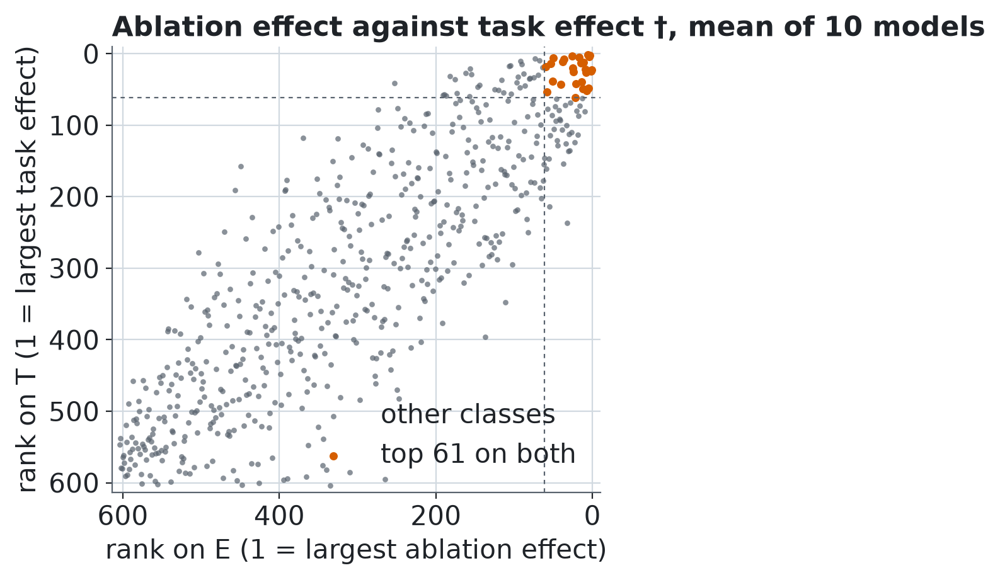

# Z4 †: a second truth at the level of the task

† Added after the study, exploratory, defined in `analysis-plan-v1.1.md` before it was run. It changes no preregistered decision. Mean over models with 95% bootstrap interval over models, seed 20261101.

`T(e)` = change of the flyvis training loss of the decoded optic flow on the Sintel clips of the study (16 clips), ablated minus intact, mean over clips (`measure/task.py`). The task truth is the top 61 classes by `T` (ties included, classes with `T <= 0` never).

**Conclusion †.** Spearman between the ablation effect E and the task effect T is 0.67 (mean over 10 models), the top-61 sets of E and T share 36.6 classes on average, and in the mean over models 34 classes are high on E but low on T and 34 the reverse; the best method against T is |weights| x neuron activity, per edge with AUROC 0.94.

## E against T per model †

| quantity | all 10 models | discovery (000-004) | replication (005-009) |
|---|---|---|---|
| Spearman(E, T) † | 0.667 [0.620, 0.711] | 0.650 [0.579, 0.719] | 0.683 [0.626, 0.740] |
| top-61 overlap of E and T (classes) † | 36.600 [34.300, 38.900] | 36.000 [32.200, 39.800] | 37.200 [34.800, 39.600] |
| Jaccard of the two top sets † | 0.431 [0.393, 0.471] | 0.423 [0.359, 0.487] | 0.440 [0.400, 0.481] |
| classes with T > 0 † | 419.100 [405.298, 433.200] | 420.600 [402.400, 441.400] | 417.600 [398.200, 437.600] |
| AUROC ceiling of T (split-half over clips) † | 0.983 [0.978, 0.989] | 0.986 [0.981, 0.991] | 0.981 [0.972, 0.990] |
| Spearman(D, T), D = relative change of the decoded flow † | 0.702 [0.657, 0.747] | 0.692 [0.633, 0.750] | 0.712 [0.646, 0.779] |
| Spearman(D, E) † | 0.935 [0.917, 0.948] | 0.924 [0.891, 0.950] | 0.946 [0.941, 0.952] |

Spearman(E, T) of the mean over the 10 models: 0.849 †.

## High and low on E and on T †

Counts of classes (high = top 61 by that quantity), mean over models, and for the mean over models.

| cell | all 10 models | discovery | replication | mean over models (one table) |
|---|---|---|---|---|
| high on E, high on T † | 36.600 [34.300, 38.900] | 36.000 [32.200, 39.800] | 37.200 [34.800, 39.600] | 27 |
| high on E, low on T † | 24.400 [22.100, 26.700] | 25.000 [21.200, 28.800] | 23.800 [21.400, 26.200] | 34 |
| low on E, high on T † | 24.400 [22.100, 26.700] | 25.000 [21.200, 28.800] | 23.800 [21.400, 26.200] | 34 |
| low on E, low on T † | 518.600 [516.300, 520.900] | 518.000 [514.200, 521.800] | 519.200 [516.800, 521.600] | 509 |

### High on E, low on T (34 classes) †

- `R2` to `L2` (rank on E 10, rank on T 81, E 12.8, T 70.4)
- `Tm3` to `L1` (rank on E 13, rank on T 62, E 7.79, T 117)
- `R2` to `Am` (rank on E 16, rank on T 73, E 1.21, T 86.5)
- `L5` to `Tm3` (rank on E 18, rank on T 87, E 0.851, T 57.1)
- `R1` to `L2` (rank on E 19, rank on T 113, E 0.624, T 36.8)
- `R5` to `L3` (rank on E 20, rank on T 80, E 0.568, T 72.9)
- `L2` to `L4` (rank on E 23, rank on T 124, E 0.293, T 31)
- `L4` to `R4` (rank on E 27, rank on T 110, E 0.154, T 40.5)
- `T2` to `Mi1` (rank on E 28, rank on T 68, E 0.151, T 97.2)
- `Mi15` to `Mi4` (rank on E 29, rank on T 135, E 0.15, T 27.8)
- `R4` to `L3` (rank on E 30, rank on T 112, E 0.137, T 39)
- `Tm2` to `L2` (rank on E 31, rank on T 136, E 0.132, T 27.7)
- `L4` to `R1` (rank on E 32, rank on T 237, E 0.131, T 8.35)
- `Mi1` to `C2` (rank on E 33, rank on T 100, E 0.131, T 48.1)
- `L2` to `Tm1` (rank on E 34, rank on T 126, E 0.129, T 30.8)
- `TmY15` to `Tm9` (rank on E 35, rank on T 72, E 0.128, T 87.1)
- `Tm1` to `L2` (rank on E 37, rank on T 154, E 0.121, T 20.8)
- `R2` to `L1` (rank on E 39, rank on T 106, E 0.112, T 44.1)
- `TmY14` to `C3` (rank on E 41, rank on T 93, E 0.107, T 53.6)
- `Mi2` to `T2` (rank on E 42, rank on T 91, E 0.106, T 54.4)
- `C2` to `L2` (rank on E 43, rank on T 79, E 0.104, T 75.6)
- `C3` to `L2` (rank on E 44, rank on T 128, E 0.0974, T 30.1)
- `T2` to `T2` (rank on E 45, rank on T 121, E 0.0941, T 32)
- `R8` to `L1` (rank on E 46, rank on T 63, E 0.0899, T 114)
- `C2` to `Mi1` (rank on E 47, rank on T 94, E 0.0891, T 53.6)
- `Mi1` to `L5` (rank on E 48, rank on T 74, E 0.0888, T 82.7)
- `L2` to `R2` (rank on E 49, rank on T 105, E 0.0883, T 44.3)
- `Mi1` to `Mi2` (rank on E 52, rank on T 86, E 0.0788, T 57.5)
- `C3` to `T1` (rank on E 54, rank on T 114, E 0.0722, T 36.4)
- `T1` to `L2` (rank on E 55, rank on T 214, E 0.0712, T 11.3)
- `L4` to `L4` (rank on E 56, rank on T 147, E 0.071, T 22.2)
- `Mi1` to `Tm3` (rank on E 57, rank on T 77, E 0.0702, T 76.4)
- `Tm3` to `TmY15` (rank on E 59, rank on T 161, E 0.0679, T 19.7)
- `R3` to `L3` (rank on E 61, rank on T 146, E 0.0602, T 22.3)

### Low on E, high on T (34 classes) †

- `Mi9` to `T4d` (rank on E 73, rank on T 7, E 0.0463, T 1.52e+03)
- `Mi4` to `T4b` (rank on E 68, rank on T 9, E 0.0494, T 1.32e+03)
- `Mi9` to `TmY3` (rank on E 92, rank on T 10, E 0.0328, T 1.22e+03)
- `CT1(M10)` to `T4c` (rank on E 90, rank on T 15, E 0.0339, T 842)
- `Mi9` to `T4b` (rank on E 105, rank on T 16, E 0.0264, T 828)
- `Mi4` to `TmY13` (rank on E 106, rank on T 17, E 0.0261, T 826)
- `CT1(Lo1)` to `T5c` (rank on E 64, rank on T 19, E 0.0548, T 656)
- `TmY15` to `TmY3` (rank on E 156, rank on T 21, E 0.0119, T 567)
- `Mi9` to `TmY18` (rank on E 162, rank on T 27, E 0.0108, T 408)
- `Mi9` to `T4a` (rank on E 88, rank on T 28, E 0.0346, T 378)
- `TmY15` to `T5d` (rank on E 155, rank on T 29, E 0.012, T 306)
- `Tm9` to `CT1(Lo1)` (rank on E 69, rank on T 30, E 0.0492, T 303)
- `TmY15` to `T4c` (rank on E 182, rank on T 31, E 0.00866, T 301)
- `R8` to `R7` (rank on E 95, rank on T 32, E 0.0315, T 281)
- `Mi1` to `T4b` (rank on E 75, rank on T 33, E 0.0444, T 277)
- `Mi4` to `TmY5a` (rank on E 80, rank on T 34, E 0.0398, T 270)
- `Mi1` to `Mi9` (rank on E 81, rank on T 35, E 0.0383, T 262)
- `TmY15` to `T4d` (rank on E 176, rank on T 36, E 0.00918, T 261)
- `CT1(M10)` to `T4a` (rank on E 116, rank on T 37, E 0.022, T 253)
- `Mi1` to `TmY18` (rank on E 97, rank on T 40, E 0.0312, T 231)
- `Mi9` to `TmY13` (rank on E 253, rank on T 41, E 0.00296, T 218)
- `TmY15` to `T5c` (rank on E 144, rank on T 44, E 0.0145, T 197)
- `Mi1` to `T4c` (rank on E 86, rank on T 45, E 0.0347, T 195)
- `TmY14` to `Tm16` (rank on E 147, rank on T 46, E 0.0138, T 182)
- `Mi9` to `Tm4` (rank on E 93, rank on T 47, E 0.0327, T 180)
- `Mi1` to `T4d` (rank on E 125, rank on T 50, E 0.0196, T 164)
- `L3` to `Mi9` (rank on E 120, rank on T 51, E 0.0208, T 153)
- `Mi1` to `CT1(M10)` (rank on E 114, rank on T 54, E 0.0224, T 146)
- `Mi9` to `C3` (rank on E 173, rank on T 55, E 0.00953, T 143)
- `C3` to `Tm4` (rank on E 104, rank on T 56, E 0.0271, T 142)
- `Mi1` to `T3` (rank on E 189, rank on T 57, E 0.0079, T 142)
- `CT1(M10)` to `T4b` (rank on E 191, rank on T 58, E 0.00772, T 136)
- `Mi2` to `TmY18` (rank on E 187, rank on T 59, E 0.00795, T 130)
- `CT1(Lo1)` to `T5b` (rank on E 157, rank on T 60, E 0.0118, T 124)

## Method ladder against T †

AUROC and share of signal for the top-61 truth by `T` (all 10 models); the last column is the AUROC of the same method against the truth by `E`.

| method | AUROC vs T | share of signal | AUPRC | precision@61 | Spearman with T | AUROC vs E |
|---|---|---|---|---|---|---|
| attribution patching † | 0.933 [0.924, 0.943] | 0.897 [0.872, 0.923] | 0.543 [0.491, 0.596] | 0.548 [0.503, 0.592] | 0.661 [0.615, 0.705] | 0.987 [0.985, 0.989] |
| gradient † | 0.880 [0.865, 0.895] | 0.786 [0.755, 0.820] | 0.418 [0.375, 0.463] | 0.428 [0.389, 0.464] | 0.605 [0.562, 0.646] | 0.961 [0.955, 0.967] |
| |weights| x neuron activity, per edge † | 0.945 [0.936, 0.954] | 0.920 [0.893, 0.948] | 0.598 [0.543, 0.651] | 0.595 [0.554, 0.634] | 0.654 [0.605, 0.699] | 0.939 [0.922, 0.955] |
| |weights| x source activity † | 0.940 [0.931, 0.950] | 0.911 [0.883, 0.940] | 0.583 [0.529, 0.638] | 0.574 [0.539, 0.607] | 0.649 [0.597, 0.695] | 0.936 [0.918, 0.952] |
| sum of |weights| † | 0.876 [0.859, 0.893] | 0.779 [0.736, 0.822] | 0.370 [0.332, 0.408] | 0.384 [0.348, 0.420] | 0.557 [0.509, 0.601] | 0.878 [0.855, 0.900] |
| |weights| x source SAE code † | 0.879 [0.844, 0.904] | 0.785 [0.707, 0.845] | 0.443 [0.396, 0.492] | 0.466 [0.423, 0.508] | 0.566 [0.492, 0.627] | 0.873 [0.831, 0.904] |
| synapse count x source activity † | 0.847 [0.831, 0.862] | 0.719 [0.680, 0.756] | 0.310 [0.280, 0.340] | 0.311 [0.280, 0.341] | 0.426 [0.388, 0.459] | 0.833 [0.813, 0.854] |
| source activity only † | 0.725 [0.701, 0.748] | 0.466 [0.415, 0.515] | 0.186 [0.171, 0.202] | 0.145 [0.120, 0.173] | 0.286 [0.258, 0.312] | 0.715 [0.687, 0.744] |
| synapse count † | 0.777 [0.761, 0.793] | 0.574 [0.537, 0.611] | 0.234 [0.218, 0.250] | 0.259 [0.239, 0.277] | 0.326 [0.285, 0.366] | 0.763 [0.737, 0.787] |
| class size † | 0.709 [0.685, 0.730] | 0.433 [0.381, 0.479] | 0.222 [0.201, 0.244] | 0.259 [0.231, 0.285] | 0.242 [0.211, 0.272] | 0.601 [0.572, 0.633] |

Rank of each class on E against its rank on T (mean over models, 1 = largest) †; dashed lines at rank 61.
