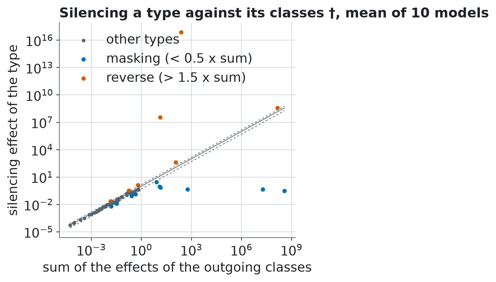

# Z6 †: silencing cell types against connections

† Added after the study, exploratory and optional, defined in `analysis-plan-v1.1.md` before it was run. It changes no preregistered decision. Mean over models with 95% bootstrap interval over models, seed 20261101.

Silencing the type A = zeroing every class whose source type is A at once, same truth metric as for one class. 63 source types occur among the classes (the plan says 64).

**Conclusion †.** Across 63 source types the silencing effect has Spearman 0.98 with the sum and 0.97 with the maximum of the effects of the outgoing classes (mean over models); 12 types are masking (below 0.5 x the sum) and 7 the reverse (above 1.5 x the sum) in the mean over models.

**Silencing can break the dynamics of the network †.** Silencing a whole type sometimes drives the network out of its working range: effects reach 7.3e+17. 12 of the 630 type x model pairs have an effect above 1000 x the median effect of their model. The conclusions therefore rest on Spearman correlations and on ranks, not on the size of the effects; the tables of masking and reverse types give the sums and ratios on a log scale (column log10 ratio) and are marked †: read them as orders of magnitude.

**Clarification of the plan, 2026-11-12.** The plan says 64 types. Of the 65 cell types, 63 are the source of at least one of the 604 classes; the other two have no outgoing class, so there is nothing to silence. †

**Cost † (measured, 2026-11-12).** 20 s per model on the GPU (RTX 5080, 63 types, 40 stimuli), about 3.5 min for 10 models. The analytic estimate made before the run (about 74 s per model, from the ablation step of the study) was 3.7 times too high. For comparison the task measurement of Z4 took 48 s per model for all 604 classes and used at most 814 MiB of GPU memory.

## Silencing effect against the effects of the outgoing classes †

| quantity | all 10 models | discovery (000-004) | replication (005-009) |
|---|---|---|---|
| Spearman(silencing, sum of class effects) † | 0.976 [0.966, 0.984] | 0.972 [0.956, 0.988] | 0.979 [0.974, 0.984] |
| Spearman(silencing, maximum class effect) † | 0.971 [0.961, 0.98] | 0.968 [0.95, 0.984] | 0.975 [0.966, 0.981] |
| types masking (silencing < 0.5 x sum) † | 8.9 [6.7, 11.1] | 9.4 [5.2, 13.2] | 8.4 [6, 10] |
| types reverse (silencing > 1.5 x sum) † | 5.9 [4.8, 6.9] | 5.8 [3.8, 7.4] | 6 [5, 7.2] |
| types with a usable ratio † | 63 [63, 63] | 63 [63, 63] | 63 [63, 63] |
| types with a non-finite effect † | 0 [0, 0] | 0 [0, 0] | 0 [0, 0] |

Types left out because the sum of their classes' effects is 0: 0 †.

## Masking types †

Silencing effect below 0.5 x the sum (mean over 10 models); 12 types.

| type | silencing † | sum of class effects † | ratio † | log10 ratio † | models masking | models reverse |
|---|---|---|---|---|---|---|
| `L4` | 0.309 | 3.76e+08 | 8.2e-10 | -9.09 | 4 | 1 |
| `C2` | 0.449 | 1.88e+07 | 2.39e-08 | -7.62 | 4 | 2 |
| `L5` | 0.467 | 600 | 0.000779 | -3.11 | 5 | 0 |
| `R2` | 0.731 | 14.2 | 0.0515 | -1.29 | 2 | 0 |
| `Mi1` | 0.936 | 12.1 | 0.0772 | -1.11 | 8 | 1 |
| `Mi9` | 0.139 | 0.443 | 0.313 | -0.504 | 8 | 0 |
| `Mi15` | 0.0827 | 0.262 | 0.315 | -0.501 | 3 | 0 |
| `Tm3` | 2.83 | 7.96 | 0.356 | -0.449 | 4 | 1 |
| `C3` | 0.1 | 0.264 | 0.38 | -0.421 | 4 | 1 |
| `Am` | 0.0126 | 0.033 | 0.38 | -0.42 | 3 | 3 |
| `Tm4` | 0.00634 | 0.0157 | 0.405 | -0.393 | 4 | 0 |
| `T2` | 0.11 | 0.266 | 0.412 | -0.385 | 1 | 0 |

## Reverse types †

Silencing effect above 1.5 x the sum (mean over 10 models); 7 types.

| type | silencing † | sum of class effects † | ratio † | log10 ratio † | models masking | models reverse |
|---|---|---|---|---|---|---|
| `Tm16` | 0.0227 | 0.0142 | 1.6 | 0.205 | 0 | 6 |
| `CT1(M10)` | 0.332 | 0.178 | 1.87 | 0.272 | 1 | 2 |
| `TmY15` | 1.32 | 0.626 | 2.11 | 0.325 | 2 | 1 |
| `R3` | 3.78e+08 | 1.41e+08 | 2.69 | 0.429 | 1 | 2 |
| `R5` | 417 | 113 | 3.68 | 0.565 | 2 | 3 |
| `L1` | 3.44e+07 | 13.2 | 2.6e+06 | 6.42 | 3 | 6 |
| `Mi4` | 7.3e+16 | 246 | 2.97e+14 | 14.5 | 2 | 4 |

Silencing effect of every source type against the sum of the effects of its classes (mean over models, log scale) †; the lines are y = x, 0.5 x and 1.5 x.
